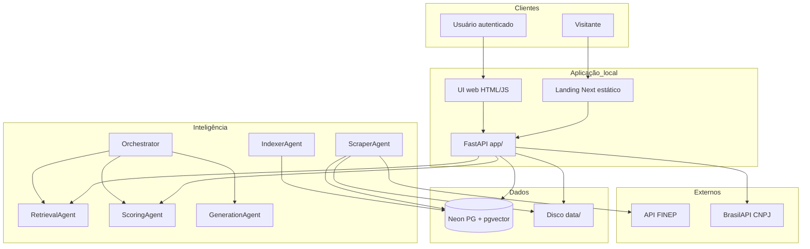
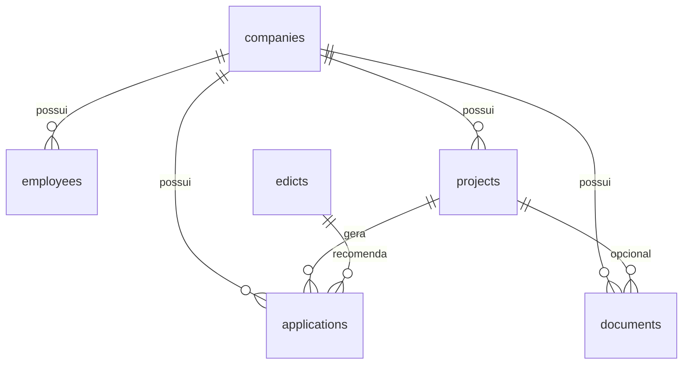

# Documentação técnica do desenvolvimento — SADS

**Sistema de Agentes de IA para Gestão e Subvenção de Editais (SADS)**  
**Finalidade:** apoio à documentação acadêmica do TCC / apresentação intermediária (TC1)  
**Natureza do documento:** análise do estado real do repositório, sem alteração de código  
**Data de elaboração desta versão:** 04/10/2026  
**Commits Git analisados:** `634f49a` (28/08/2026) · `3bdd41d` (01/10/2026)  
**Versão da API declarada em código:** `0.4.0` (`app/main.py`)

> **Princípio de evidência.** Afirmações neste documento estão ancoradas em código-fonte, SQL, dependências, testes, README, ADRs e diários do repositório. Quando a evidência for insuficiente, registra-se *não identificado nos materiais analisados*. Requisitos derivados do código ou da documentação interna são rotulados como **requisitos reconstruídos**, e não como levantamento formal prévio com stakeholders externos.

---

## 1. Visão geral da aplicação

### 1.1 Problema abordado

Empresas e organizações que desenvolvem projetos de inovação enfrentam dificuldade para localizar, interpretar e comparar editais de fomento público. As oportunidades estão dispersas em instituições distintas (FINEP, FAPs, BNDES, entre outras), com critérios de elegibilidade heterogêneos, documentos extensos e prazos curtos. No escopo do protótipo atual, o corpus operacional restringe-se às chamadas **FINEP** com situação aberta — decisão documentada em `docs/DECISOES_ARQUITETURAIS.md` (ADR-006) e no diário técnico. A tentativa de integração oficial com a Loja de APIs do BNDES **não obteve autorização** no prazo; o sistema trata o BNDES apenas como opção ampla de crédito (ADR-009), sem recomendar programas específicos.

O problema de pesquisa, conforme documentação do grupo (`docs/MANUAL_COMPLETO_SADS.md`), pode ser enunciado assim: *como apoiar, de maneira estruturada e explicável, a identificação de mecanismos de fomento compatíveis com o perfil de uma organização e de seu projeto de inovação?*

### 1.2 Objetivo da aplicação

O SADS é um **sistema de apoio à decisão (SAD)** que:

1. cadastra organização e usuários;
2. recebe o projeto (PDF + formulário);
3. cruza o perfil e o texto do projeto com um corpus indexado de editais;
4. produz um ranking de aderência com nota, breakdown, forças, fraquezas e link para a chamada;
5. registra o histórico de recomendações/aplicações.

O sistema **não** garante aprovação em edital, **não** realiza submissão oficial ao órgão financiador e **não** substitui consultoria jurídica ou especialista em fomento.

### 1.3 Público-alvo

| Perfil | Situação no PoC | Evidência |
|--------|-----------------|-----------|
| Visitante | Landing pública | `landing/out`, rota `/` |
| Funcionário autenticado da organização | Área logada (`web/`) | login/register + token |
| Admin da organização | Papel padrão no cadastro (`role=admin`) | `routes_auth.register`, campo `employees.role` |
| Curador de catálogo / SSO corporativo | Planejado | README Fase B; não há painel dedicado |

Integrantes citados na documentação do grupo: Letícia Melo, Filipe Ribeiro, Fabiano Rocha, Ruben Pereira e Victor Yukio (curso Ciência da Computação — UNIP Paraíso, conforme `docs/MANUAL_COMPLETO_SADS.md`). A confirmação formal da composição da banca e do título institucional compete à equipe.

### 1.4 Principais funcionalidades (versão atual — Fase A)

- Landing institucional (Next.js exportado estaticamente).
- Registro de organização + primeiro usuário admin; login com senha; recuperação de senha (SMTP opcional).
- Painel (dashboard), equipe, materiais, aplicações.
- Upload de projeto em PDF, extração de texto, formulário editável.
- Consulta de CNPJ via BrasilAPI (autofill).
- Coleta e indexação de editais FINEP (pipeline CLI).
- Avaliação (`POST /projects/{id}/evaluate`): retrieval híbrido + scoring matriz v2 + persistência em `applications`.
- Relatório explicável na UI (`project-evaluate.html`).
- Pipeline E2E CLI/API (`Orchestrator`, `POST /api/v1/submit-project`) com geração por template.

### 1.5 Escopo e limites da versão atual

| Dentro do escopo (PoC / Fase A) | Fora do escopo / Fase B |
|---------------------------------|-------------------------|
| Neon + pgvector, coleta FINEP, embeddings, retrieval, scoring, template LLM desligado, FastAPI, UI Fase A | Chat com LLM, SSO/OAuth, SaaS completo, scraper multi-portal em produção, AHP/TOPSIS formais, billing, treino automático |

**Limite científico importante:** resultados de ranking não devem ser generalizados para “todo o fomento brasileiro”, pois o corpus piloto é FINEP-only.

---

## 2. Levantamento e análise de requisitos

### 2.1 Como as necessidades foram identificadas (conforme evidências)

Não foi encontrado, nos materiais analisados, um documento formal de entrevista com usuários externos ou ata de elicitation com stakeholders de mercado. As necessidades aparentes derivam de:

1. **Proposta e materiais acadêmicos** em `docs/TCC/` (proposta, APS, slides).
2. **Backlog técnico** com IDs T-001…T-042 e UI-A no `README.md`.
3. **ADRs** em `docs/DECISOES_ARQUITETURAIS.md`.
4. **Código e UI** (contratos Pydantic, rotas, telas).
5. **Diário de erros** (`docs/TCC/diario_erros_testes_solucoes.md`), que registra ajustes oriundos de demo e orientação (ex.: remoção de TRL do formulário — E12).

Portanto, os requisitos abaixo são **reconstruídos** a partir dessas fontes.

### 2.2 Requisitos funcionais (reconstruídos)

| ID | Descrição | Origem / evidência | Prioridade | Status | Validação |
|----|-----------|--------------------|------------|--------|-----------|
| RF01 | Cadastrar organização e primeiro usuário admin | `routes_auth.register`, `register.html` | Alta | Implementado | Teste manual M05; sem teste automatizado de auth |
| RF02 | Autenticar usuário (empresa + e-mail + senha) e emitir token | `auth.py`, `login.html` | Alta | Implementado | Manual; `Depends(get_current_user)` nas rotas auth |
| RF03 | Recuperar / redefinir senha | forgot/reset + `mailer.py` | Média | Parcial (SMTP opcional; link em dev) | Manual |
| RF04 | Exibir dashboard com métricas da organização | `GET /dashboard`, `dashboard.html` | Alta | Implementado | Manual |
| RF05 | Manter dados da empresa (CRUD parcial) | `routes_fase_a` companies | Alta | Implementado | Manual |
| RF06 | Gerenciar equipe (employees) | `employee.html`, rotas employees | Média | Implementado (RBAC fino parcial) | Manual |
| RF07 | Criar projeto via upload de PDF | `POST /projects`, `project-new.html` | Alta | Implementado | Manual + `test_extract_pdfs` / `test_pdf_form` |
| RF08 | Extrair texto do PDF e sugerir campos do formulário | `extract_pdfs`, `pdf_form.py` | Alta | Parcial (sem OCR) | Testes unitários de heurísticas |
| RF09 | Avaliar projeto e gerar ranking top-N | `evaluate_project`, retrieval + scoring | Alta | Implementado | Unitários scoring/retrieval; manual M05 |
| RF10 | Persistir recomendações em applications | modelo `Application`, UI applications | Alta | Implementado | Manual |
| RF11 | Registrar outcomes (aprovado/rejeitado etc.) | `PATCH /applications` | Média | Implementado | Manual |
| RF12 | Gerenciar materiais/documentos | `documents` + `materials.html` | Média | Implementado | Manual (E11 consistência) |
| RF13 | Consultar CNPJ para autofill | `cnpj_lookup.py`, BrasilAPI | Baixa | Implementado | Unitários normalize/porte; integração depende da API |
| RF14 | Coletar e atualizar corpus FINEP | `finep.py`, `refresh_finep_corpus` | Alta | Implementado (piloto) | `test_finep_source`; reload documentado 31 chamadas |
| RF15 | Indexar embeddings dos editais | `indexer_agent`, pgvector | Alta | Implementado | Pipeline operacional; embedding unitário hashing |
| RF16 | Gerar rascunho/relatório por template (pipeline) | `generation_agent`, `llm.py` | Média | Implementado (CLI/API submit-project) | `test_llm`, `test_generation_pipeline` |
| RF17 | Landing pública institucional | `landing/` | Média | Implementado | Manual |
| RF18 | Chat com LLM assistido | `product_ui.md` Fase B | — | Planejado | — |
| RF19 | SSO / OAuth | README Fase B | — | Planejado | — |
| RF20 | Catálogo multi-fonte (FAPESP etc.) | `fapesp.py` + `embrapii.py`; `bndes.py` ampla (ADR-009); CNPq/Centelha rasas; piloto FINEP | Parcial (Hit@k multi-fonte pendente) | — |

### 2.3 Requisitos não funcionais (reconstruídos)

Não foram encontradas metas numéricas formais de desempenho (latência, throughput) ou SLA de disponibilidade. Não se atribuem percentuais inventados.

| ID | Descrição | Aspecto | Origem / evidência | Status | Validação |
|----|-----------|---------|--------------------|--------|-----------|
| RNF01 | Senhas não armazenadas em texto puro (PBKDF2-SHA256, 200k iterações) | Segurança | `app/auth.py` | Implementado | Revisão de código |
| RNF02 | Token de sessão assinado (HMAC) com expiração configurável | Segurança | `AUTH_SECRET`, `AUTH_TOKEN_TTL_HOURS` | Implementado | Revisão de código |
| RNF03 | Segredos em `.env` não versionados | Segurança | `.env.example`, `.gitignore` | Implementado | Inspeção de repo |
| RNF04 | Isolamento lógico multi-tenant por `company_id` | Segurança / privacidade | models + ADR-007 | Parcial (authz server-side incompleta nas rotas Fase A) | Revisão de código |
| RNF05 | LLM externo desligado por padrão (privacidade / custo) | Privacidade / custo | ADR-003, `LLM_PROVIDER=none` | Implementado | `test_llm` |
| RNF06 | Fallback de embeddings offline (`hashing`) sob restrição de rede | Disponibilidade / compatibilidade | ADR-008, diário E03 | Implementado | `test_embeddings` |
| RNF07 | Python 3.10–3.12 recomendado | Compatibilidade | README | Orientação documentada | Setup |
| RNF08 | Explicabilidade do ranking (breakdown persistido) | Usabilidade / auditabilidade | `applications.breakdown`, UI relatório | Implementado | Manual + unitários scoring |
| RNF09 | Interface utilizável em desktop via browser | Usabilidade | `web/`, landing | Implementado (escopo PoC) | Manual |
| RNF10 | Acessibilidade (WCAG etc.) | Acessibilidade | — | Não identificado nos materiais analisados | Confirmar com equipe |
| RNF11 | HTTPS em produção | Segurança / comunicação | — | Não identificado no deploy local | Depende do host |
| RNF12 | Conformidade LGPD formal | Proteção de dados | menções em docs; política formal incompleta | Parcial / planejado | Não afirmar conformidade sem avaliação |

### 2.4 Regras de negócio (reconstruídas do código)

1. **Corpus vs projeto:** o texto do projeto participa da análise em tempo de uso; não é gravado na tabela de editais como item do corpus público (`docs/ARQUITETURA_SADS.md`).
2. **Filtro temporal FINEP:** preferência por situação “Aberta” (`abert*`) no coletor.
3. **Score 0–100** com pesos fixos matriz v2: similaridade 0,30; área 0,25; TRL 0,15; porte 0,15; região 0,10; orçamento 0,05.
4. **Gates soft** de elegibilidade (prazo, porte, TRL, região) influenciam elegibilidade e ordenação (`eligible` primeiro, depois score).
5. **Faixas de interpretação:** ≥75 ALTA; 50–74 MÉDIA; &lt;50 BAIXA (diário técnico).
6. **Metadados ausentes:** critérios com informação faltante tendem a nota neutra (~70), para não punir artificialmente (E19).
7. **Reavaliação:** novas recomendações substituem applications antigas com status `recommended`/`draft` do mesmo projeto.
8. **Onboarding:** registro cria `Company` + primeiro `Employee` admin com senha.
9. **Score não é garantia de aprovação.**

### 2.5 Perfis e permissões

| Perfil | Permissões observadas | Limitação |
|--------|----------------------|-----------|
| Visitante | Landing | Sem token |
| Usuário autenticado | Opera UI com `company_id` da sessão | Rotas Fase A em geral **não** aplicam `Depends(get_current_user)` — isolamento depende do cliente enviar o `company_id` correto |
| Admin | `role` default no register | Pouca diferenciação de UI/API por papel (RBAC fino parcial) |

### 2.6 Casos de uso / histórias (reconstruídos)

| ID | História | Status |
|----|----------|--------|
| UC01 | Como visitante, quero entender o produto na landing | Implementado |
| UC02 | Como responsável, quero criar conta da minha organização | Implementado |
| UC03 | Como usuário, quero autenticar-me e acessar o painel | Implementado |
| UC04 | Como analista, quero enviar o PDF do projeto e completar o formulário | Implementado (extração parcial) |
| UC05 | Como analista, quero receber ranking justificável de editais | Implementado (FINEP) |
| UC06 | Como analista, quero registrar o desfecho da aplicação | Implementado |
| UC07 | Como operador, quero atualizar o corpus FINEP | Implementado via CLI (não pela UI) |
| UC08 | Como usuário corporativo, quero login SSO | Planejado |

---

## 3. Tecnologias e ferramentas utilizadas

Versões abaixo refletem o que é **verificável** em `requirements*.txt` e `landing/package.json`. Intervalos (`>=`, `<`) indicam faixas declaradas, não necessariamente a versão exata instalada no ambiente de cada integrante.

| Tecnologia | Função no projeto | Onde aparece | Versão verificável | Justificativa |
|------------|-------------------|--------------|--------------------|---------------|
| Python | Linguagem backend / agentes / scripts | `app/`, `agents/`, `scripts/`, `tests/` | 3.10–3.12 recomendado (README) | Adequação técnica: ecossistema ML/HTTP; motivação original da equipe além do README — não detalhada formalmente |
| FastAPI | API HTTP + OpenAPI | `app/main.py`, routers | `>=0.115,<1` | API assíncrona e tipagem; ADR implícito no stack |
| Uvicorn | Servidor ASGI | README setup | `>=0.32,<1` | Servir FastAPI localmente |
| SQLAlchemy (asyncio) + asyncpg | ORM / driver Postgres | `db/` | SQLAlchemy `>=2.0.36,<3`; asyncpg `>=0.30,<1` | Persistência async |
| Pydantic Settings | Configuração | `app/config.py` | `>=2.6,<3` | Settings tipados a partir de `.env` |
| PostgreSQL + pgvector (Neon) | Banco relacional + vetores | `DATABASE_URL`, SQL `db/init/` | Neon cloud (versão do servidor não fixada no repo) | **ADR-001** registrada |
| sentence-transformers | Embeddings semânticos | `app/embeddings.py` | `>=3.0,<6`; modelo default `all-MiniLM-L6-v2` | Similaridade; fallback hashing **ADR-008** |
| HashingVectorizer (via stack sklearn do ST / implementação local) | Embeddings offline | `EMBEDDING_BACKEND=hashing` | — | Rede corporativa / demo resiliente |
| pypdf | Extração de texto PDF | scripts / fluxo projeto | `>=5,<6` | Ingestão de editais e projetos |
| httpx | HTTP cliente | FINEP, BrasilAPI | `>=0.27,<1` | Integrações |
| BeautifulSoup4 | Parsing HTML/API | coletor FINEP | `>=4.12,<5` | Extração de conteúdo |
| python-multipart | Upload multipart | FastAPI projects/documents | `>=0.0.9` | Upload PDF |
| Next.js + React + Tailwind | Landing | `landing/` | Next `^15.5.4`; React `^19.1.1`; Tailwind `^3.4.17` | **ADR-005** — marketing rápido |
| HTML/CSS/JS estático | UI autenticada Fase A | `web/` | — | **ADR-005** — velocidade de entrega |
| pytest (+ pytest-asyncio) | Testes automatizados | `tests/`, `requirements-dev.txt` | pytest `>=8,<9` | Suíte unitária |
| Git / GitHub | Controle de versão | histórico do repo | 2 commits principais na `main` | Processo de desenvolvimento |
| BrasilAPI | Lookup CNPJ | `app/cnpj_lookup.py` | API externa | Autofill cadastral |
| API FINEP (Liferay `/o/c/chamadapublicas`) | Fonte de editais | `agents/sources/finep.py` | — | **ADR-006** |
| Cursor (assistente de IA) | Apoio à implementação e docs | commit `3bdd41d` (`Co-authored-by: Cursor`) | — | Ferramenta; decisões da equipe |

**Mencionados, porém não usados como dependência runtime do pipeline atual:** LangChain/CrewAI (README “opcional”); Playwright (scraping futuro).  
**Docker:** citado no README como opcional; **arquivo `docker-compose.yml` não está presente** no working tree analisado em 04/10/2026.

Análise de adequação sem comprovação da motivação original: a combinação FastAPI + Postgres/pgvector + módulos Python próprios é tecnicamente coerente com um PoC acadêmico de retrieval + scoring explicável, com baixo acoplamento a frameworks de agentes e custo zero de LLM no fluxo padrão.

---

## 4. Arquitetura e organização do sistema

### 4.1 Estilo arquitetural

O sistema em execução local concentra-se em **um processo Uvicorn** que serve API, arquivos estáticos da UI (`web/`) e a landing exportada (`landing/out`). O estado persistente fica no **Neon** (Postgres remoto) e em arquivos locais sob `data/`. Há **integrações externas** (FINEP, BrasilAPI). Não há evidência de múltiplos microsserviços implantados; classificar o PoC como “sistema distribuído completo” seria exagero — há componentes remotos (DB cloud + APIs), mas a aplicação é um **monólito modular** com jobs CLI.

### 4.2 Diagrama de arquitetura



### 4.3 Componentes e responsabilidades

| Componente | Path | Responsabilidade |
|------------|------|------------------|
| Gateway HTTP | `app/main.py` | Health, static, landing, `submit-project` |
| Auth | `app/auth.py`, `routes_auth.py` | Register/login/token/reset |
| Fase A API | `app/routes_fase_a.py` | Companies, projects, evaluate, docs, apps, dashboard |
| Schemas | `app/schemas.py` | Contratos Pydantic |
| Embeddings / LLM | `app/embeddings.py`, `app/llm.py` | Vetores; template se `none` |
| ORM / sessão | `db/models.py`, `db/session.py` | Entidades e async session |
| Agentes | `agents/*.py` | Pipeline inteligente |
| Jobs | `scripts/*` | migrate, collect, index, refresh, pipeline |
| UI | `web/*`, `landing/` | Fase A + marketing |

### 4.4 Duas faixas de processamento

1. **Faixa A — corpus (offline/ops):** Scraper → extract/seed → Indexer → `edicts.embedding`.
2. **Faixa B — online (usuário):** UI/API → Retrieval → Scoring → `applications` (+ Orchestrator/Generation no E2E).

### 4.5 Fluxo de operação importante (avaliação de projeto)

1. Usuário autenticado abre `project-new.html` e envia PDF.
2. `POST /api/v1/projects` valida PDF, grava arquivo em `data/uploads/<company_id>/`, extrai texto, preenche `raw_text` e sugere `form_data`.
3. Usuário revisa formulário (`PATCH`) e solicita avaliação.
4. `POST /api/v1/projects/{id}/evaluate` monta `CompanyProfile` + `ProjectQuery`.
5. `RetrievalAgent` busca candidatos (filtros SQL + similaridade de cosseno em pgvector).
6. `ScoringAgent` calcula notas, gates e ordenação.
7. Top-N é persistido em `applications`; projeto passa a `status=evaluated`.
8. UI `project-evaluate.html` exibe ranking, breakdown e URL FINEP.

### 4.6 Organização de pastas (resumo)

```
agents/   componentes inteligentes
app/      FastAPI, auth, rotas, embeddings, llm, cnpj, pdf_form
db/       models, session, init SQL
web/      UI autenticada
landing/  marketing Next → out/
scripts/  jobs operacionais
data/     pdfs, texts, outputs, uploads (local)
tests/    unitários
docs/     manuais e TCC
```

---

## 5. Modelagem e persistência de dados

### 5.1 Modelo implementado



| Entidade | Campos principais | Observações |
|----------|-------------------|-------------|
| `companies` | name, trade_name, size, trl, areas[], cnpj, uf, city, cnae, email, phone, revenue_brl, metadata | Tenant |
| `employees` | company_id, name, email, password_hash, role, is_active, … | UNIQUE (company_id, email) |
| `projects` | company_id, created_by, title, file_path, raw_text, status, form_data, metadata | status draft/evaluated… |
| `documents` | company_id, project_id?, filename, file_path, doc_type, … | Materiais |
| `applications` | project_id, company_id, edict_id?, score, breakdown, strengths/weaknesses, status, outcomes… | Ranking + desfecho |
| `edicts` | external_id unique, source, title, agency, areas, min_trl, company_sizes, raw_text, embedding vector(384), url, metadata | Corpus |

Integridade: FKs com `ON DELETE CASCADE` / `SET NULL` conforme SQL em `db/init/02_schema.sql`, `03_fase_a.sql`, `04_auth.sql`. Embeddings em dimensão **384**.

### 5.2 Operações CRUD (padrão observado)

- **Create/Read/Update** via rotas FastAPI + SQLAlchemy async.
- **Delete** de documents/projects com regras de consistência ajustadas (diário E11).
- **Upsert** de editais no seed/refresh FINEP.
- Consultas vetoriais via SQL/`pgvector` no retrieval.

### 5.3 Propostas futuras (não confundir com o modelo atual)

AHP/TOPSIS não alteram o schema atual de pesos (constantes em código). Multi-fonte exigirá taxonomia unificada de metadados. Chat/SSO podem exigir novas entidades de sessão/consentimento — **não identificadas** como tabelas implementadas.

---

## 6. Processo de desenvolvimento e implementação

### 6.1 Etapas comprováveis

| Período / marco | Evidência | Conteúdo |
|-----------------|-----------|----------|
| 28/08/2026 | commit `634f49a` | Estrutura inicial T-001 (pastas, README, planilha de sprints) |
| Evolução no working tree | docs de backlog T-002…T-042, UI-A | Agentes, Neon, LLM none, retrieval, scoring, UI |
| 30/09/2026 | diário técnico, manuais | Matriz v2, reload FINEP (31), consolidação TC1 |
| 01/10/2026 | commit `3bdd41d` | PoC Fase A + docs TC1; *Co-authored-by: Cursor* |

Não há evidência suficiente para afirmar adoção formal de Scrum, Kanban ou TDD como metodologia oficial do grupo. O que se observa é **desenvolvimento iterativo por tarefas numeradas (T-xxx)**, com correções registradas no diário e cobertura parcial por testes.

### 6.2 Divisão e implementação das funcionalidades

Funcionalidades foram organizadas em backlog (`README` status) e módulos por responsabilidade (`agents/` vs `app/` vs `web/`). A UI autenticada foi entregue como HTML/JS para acelerar a Fase A, enquanto a landing usou Next.js (ADR-005) — divergindo, em parte, de propostas anteriores que citavam app React/Auth.js completa.

### 6.3 Integração entre componentes

- Contratos `dataclass` entre agentes (`CompanyProfile`, `ProjectQuery`, `EdictMatch`, `ScoreReport`).
- Persistência centralizada em Neon.
- UI consome `/api/v1/*`; token em `localStorage` (`web/app.js`).
- Corpus atualizado por CLI, separado da UI (E15).

### 6.4 Controle de versão

- Repositório Git; branch `main`; remote `origin/main`.
- Dois commits principais na linha analisada.
- `.env` e segredos fora do versionamento.

### 6.5 Uso do assistente de IA

**Evidência:** o commit `3bdd41d` registra `Co-authored-by: Cursor <cursoragent@cursor.com>`, e há volume significativo de código/documentação gerado com apoio da ferramenta.

**Distinção necessária para a banca:**

| Papel da IA (apoiado pela evidência de co-autoria e artefatos) | Papel da equipe (a validar/afirmar na apresentação) |
|---------------------------------------------------------------|-----------------------------------------------------|
| Acelerar implementação de módulos, testes e documentação | Definir problema de pesquisa, escopo MVP e ADRs |
| Sugerir correções a partir de erros (rede, ranking, UI) | Validar comportamento em demo e aceitar/rejeitar mudanças |
| Organizar material TC1 | Responsabilidade acadêmica e ética pelo conteúdo entregue |

A equipe deve declarar explicitamente que a IA **não treina modelo próprio no SADS** e que decisões de pesos, corpus FINEP e privacidade (`LLM_PROVIDER=none`) foram **adotadas e são defendidas pelo grupo**.

### 6.6 Decisões registradas da equipe

Ver ADRs 001–008 (`docs/DECISOES_ARQUITETURAIS.md`): Neon, agentes Python puros, LLM none, matriz de pesos (não AHP ainda), UI híbrida Next+HTML, FINEP-only, multi-tenant por `company_id`, embeddings com fallback hashing.

---

## 7. Descrição técnica das funcionalidades

### 7.1 Autenticação e onboarding

- **Objetivo:** criar tenant e sessão.
- **Fluxo:** register → Company + Employee admin → token; login → token; `/me` com Bearer.
- **Arquivos:** `routes_auth.py`, `auth.py`, `login.html`, `register.html`, `forgot-password.html`, `reset-password.html`.
- **Entradas:** nome empresa, e-mail, senha (+ dados cadastrais opcionais).
- **Saídas:** `access_token` + dados do usuário.
- **Validações:** empresa duplicada (409); senha via PBKDF2; token com `exp`.
- **Erros:** 401/409 HTTP.
- **Estado:** implementado; SSO planejado; SMTP de reset parcial.

### 7.2 Dashboard, equipe, materiais, aplicações

- CRUD e listagens por `company_id` em `routes_fase_a.py` + telas `web/*.html`.
- Dashboard agrega contagens e métricas (incl. outcomes quando houver).
- **Estado:** implementado; RBAC fino e authz server-side parciais.

### 7.3 Projeto PDF + formulário

- **Fluxo:** upload → disco → `pypdf` → `guess_form_fields` → edição humana → evaluate.
- **Arquivos:** `project-new.html`, `routes_fase_a` projects, `pdf_form.py`, `extract_pdfs.py`.
- **Limitação:** PDFs escaneados sem OCR.
- **Estado:** implementado com extração parcial.

### 7.4 Coleta e indexação FINEP

- **Fluxo ops:** `refresh_finep_corpus` / `collect_editais` → PDFs em `data/raw_pdfs` → textos → seed → `index_edicts`.
- **Arquivos:** `scraper_agent.py`, `sources/finep.py`, scripts de corpus.
- **Estado:** piloto implementado; não há botão de reload na UI.

### 7.5 Retrieval + Scoring + relatório

- **Objetivo:** ranking explicável top-N (UI usa tipicamente `top_n=5`, `k=8` conforme diário E18).
- **Arquivos:** `retrieval_agent.py`, `scoring_agent.py`, `evaluate_project`, `project-evaluate.html`.
- **Saídas:** applications com score, breakdown, strengths/weaknesses, summary, URL.
- **Erros:** HTTP 500 com detalhe de falha na avaliação; 404 projeto/empresa.
- **Estado:** núcleo implementado; AHP/TOPSIS planejados; qualidade limitada por metadados FINEP.

### 7.6 Generation / Orchestrator

- **Objetivo:** relatório Markdown E2E sem API paga.
- **Arquivos:** `generation_agent.py`, `orchestrator.py`, `llm.py`, `POST /api/v1/submit-project`.
- **Estado:** implementado no pipeline; UI de evaluate enfatiza ranking persistido (generation completa mais associada ao CLI/API legado).

### 7.7 CNPJ lookup

- **Arquivo:** `cnpj_lookup.py`.
- **Estado:** implementado com fallback de verificação SSL em rede corporativa (diário E03/E14).

---

## 8. Segurança e proteção de dados

### 8.1 Medidas implementadas

| Medida | Evidência |
|--------|-----------|
| Hash de senha PBKDF2-SHA256 (200.000 iterações) + `hmac.compare_digest` | `app/auth.py` |
| Token assinado HMAC com expiração | `create_access_token` |
| Segredos via `.env` / `.env.example` sem valores reais | repo |
| LLM desligado no fluxo padrão | `LLM_PROVIDER=none` |
| Separação corpus de editais × documentos de projeto | fluxo evaluate / ADRs |
| Multi-tenant lógico por `company_id` | models |
| Reset de senha com token de propósito específico | `password_reset` |

### 8.2 Limitações e recomendações futuras (não apresentar como já resolvidas)

1. **Autorização incompleta:** rotas Fase A listadas em `routes_fase_a.py` não usam, em geral, `Depends(get_current_user)` — risco de acesso cruzado se `company_id` for manipulado.
2. **RBAC fino** pouco enforced.
3. **HTTPS / hardening de produção** não evidenciados no ambiente local.
4. **SMTP** de reset opcional.
5. **PDF malicioso / prompt injection:** texto extraído entra no retrieval — risco reconhecido nos docs; sanitização futura.
6. **LGPD:** há preocupação arquitetural (finalidade, minimização, não treinar com projeto), mas **não há evidência de avaliação jurídica formal nem política completa de direitos do titular**. Não afirmar conformidade.

Nesta documentação **não se reproduzem** senhas, tokens ou connection strings reais.

---

## 9. Testes e validação

### 9.1 Testes automatizados existentes

Arquivos em `tests/`:

| Arquivo | Foco |
|---------|------|
| `test_config.py` | URL async, hint de host sem senha |
| `test_embeddings.py` | chunk, hashing dim 384 |
| `test_db_helpers.py` | helpers SQL/áreas/slug |
| `test_extract_pdfs.py` | slugify/clean |
| `test_pdf_form.py` | guess campos + CNPJ helpers |
| `test_finep_source.py` | filtro situação, anexos, temas |
| `test_retrieval.py` | cosseno, reasons |
| `test_scoring.py` | pesos, critérios, ordenação elegível |
| `test_llm.py` | provider none / template |
| `test_generation_pipeline.py` | seções de score no draft |

### 9.2 Testes efetivamente executados (com registro)

| Quando | O quê | Resultado | Evidência |
|--------|-------|-----------|-----------|
| 30/09/2026 | Subconjunto scoring + generation | 11 passed (após matriz v2) | `diario_erros_testes_solucoes.md` |
| 04/10/2026 | Suíte `pytest tests -q` neste ambiente de análise | **40 passed**, 1 warning (deprecação pytest-asyncio) | execução local na elaboração deste documento |
| 30/09/2026 | Reload corpus FINEP `--all` | 31 chamadas abertas com PDF; 31/31 embeddings (hashing) | diário §4.1 |

**Limitação:** não há, nos materiais, histórico completo de CI contínuo nem relatórios JUnit versionados. Testes de autenticação/autorização E2E **não** foram identificados na suíte.

### 9.3 Verificações manuais documentadas

Checklist M01–M07 no diário (check_env, migrate, refresh FINEP, uvicorn, fluxo PDF→evaluate, delete material, smoke CLI).

### 9.4 Tabela de cenários

| Funcionalidade / requisito | Cenário | Procedimento / entrada | Resultado esperado | Resultado observado | Situação | Evidência |
|----------------------------|---------|------------------------|--------------------|---------------------|----------|-----------|
| RNF05 / RF16 | LLM none | `get_llm_client` / generation | Template local sem API | OK em unitários | Automatizado passou | `test_llm.py` |
| RF09 scoring | Pesos somam 1,0 | `SCORE_WEIGHTS` | Soma = 1 | OK | Automatizado passou | `test_scoring.py` |
| RF09 | Elegíveis antes de inelegíveis | matches mistos | Ordenação `eligible` desc | OK | Automatizado passou | `test_scoring.py` |
| RF14 | Situação Aberta | metadados FINEP | Filtra `abert*` | OK | Automatizado passou | `test_finep_source.py` |
| RF08 | Guess formulário | texto sintético | áreas/orçamento | OK unitário | Automatizado passou | `test_pdf_form.py` |
| RF09 E2E UI | PDF real → evaluate | M05 | Top-N + breakdown | Documentado como checklist; execução específica por demo **a confirmar pela equipe** | Manual proposto | diário M05 |
| Authz | Acesso a `company_id` alheio | token A + id B | 403/401 | **Não verificado** na suíte | Pendente | STATUS / ADR |
| Hit@k ranking | Ground truth anotado | 3–5 projetos | Métricas Hit@3/@5 | **Não executado** como experimento formal nos materiais | Pendente | diário §4.3 |

### 9.5 Roteiro sugerido (não executar como se já tivesse sido feito)

1. `python -m scripts.check_env` e `migrate_db`.
2. `pytest tests -q`.
3. Subir API com `EMBEDDING_BACKEND=hashing`.
4. Registrar empresa → login → upload PDF de estudo de caso → evaluate.
5. Conferir top-5, pesos, URL FINEP, gravação em applications.
6. Tentar acessar recurso de outro `company_id` (teste negativo de authz) e registrar resultado.
7. Opcional: comparar hashing vs MiniLM se a rede permitir.

---

## 10. Problemas encontrados e soluções adotadas

Síntese a partir do diário E01–E20 (detalhes completos em `docs/TCC/diario_erros_testes_solucoes.md`).

| ID | Problema | Causa (quando conhecida) | Solução | Verificação | Situação |
|----|----------|--------------------------|---------|-------------|----------|
| E02 | Docker só em um PC | Runtime local ≠ editor | Migração para Neon | check_env / migrate | Resolvido como estratégia |
| E03 | Proxy/SSL bloqueia HF/APIs | Rede corporativa | `EMBEDDING_BACKEND=hashing`; LLM none; CNPJ com fallback SSL | testes embeddings/llm | Mitigado |
| E07 | Editais encerrados no corpus | Filtro inconsistente | Situação Aberta | `test_finep_source` | Resolvido no coletor |
| E08 | Limit truncava universo | Default de dev | `--all` / limit None | reload 31 | Resolvido |
| E11 | Contagem dashboard inconsistente | Delete sem cascata adequada | Ajuste delete projeto/documento | checklist M06 | Resolvido (conforme diário) |
| E12 | TRL no form gerava ruído | Desalinhamento domínio/UI | Remoção do campo; TRL opcional no score | revisão UI | Resolvido |
| E16 | Ranking só por similaridade | Peso 50% sim | Matriz v2 30% sim + 70% estruturado | `test_scoring` | Resolvido no PoC |
| E17 | TRL sempre neutro no evaluate | Bug montagem profile | Usar form/empresa | integração | Resolvido conforme diário |
| Authz Fase A | Isolamento frágil | Falta Depends nas rotas | Pendente hardening | — | **Pendência crítica** |
| Metadados FINEP | Notas pouco discriminativas | Campos vazios no seed | Neutro ~70; extração futura | — | **Pendência** |
| OCR | PDF escaneado | Sem OCR | — | — | **Pendência** |

---

## 11. Execução e ambiente

### 11.1 Pré-requisitos

- Python 3.10–3.12 recomendado.
- Conta Neon com `CREATE EXTENSION vector`.
- (Opcional) Node.js para rebuild da landing.
- Arquivo `.env` a partir de `.env.example`.

### 11.2 Instalação e comandos

```powershell
python -m venv .venv
.\.venv\Scripts\Activate.ps1
pip install -r requirements.txt
pip install -r requirements-dev.txt
copy .env.example .env
# editar DATABASE_URL e AUTH_SECRET

python -m scripts.check_env
python -m scripts.migrate_db

$env:EMBEDDING_BACKEND="hashing"
uvicorn app.main:app --reload --host 127.0.0.1 --port 8000

# testes
python -m pytest tests -q

# corpus (ops)
python -m scripts.refresh_finep_corpus --limit 20
```

URLs locais: `/`, `/login.html`, `/dashboard.html`, `/health`, `/docs`.

### 11.3 Variáveis de ambiente (sem valores sensíveis)

| Variável | Função |
|----------|--------|
| `DATABASE_URL` | Conexão Postgres Neon |
| `LLM_PROVIDER` | `none` (padrão) |
| `EMBEDDING_MODEL_NAME` / `EMBEDDING_BACKEND` | Modelo / `auto`\|`hashing` |
| `AUTH_SECRET` / `AUTH_TOKEN_TTL_HOURS` / `AUTH_RESET_TTL_MINUTES` | Segurança de sessão |
| `APP_PUBLIC_URL` | Links de reset |
| `SMTP_*` | E-mail opcional |
| `DATA_DIR`, `RAW_PDFS_DIR`, `TEXTS_DIR`, `OUTPUTS_DIR` | Paths locais |

### 11.4 Ambientes

| Ambiente | Situação |
|----------|----------|
| Local (dev) | Documentado e utilizado |
| Testes automatizados | pytest local; sem DB obrigatório na maioria dos unitários |
| Produção pública | **Não identificado** deploy oficial nos materiais analisados |

---

## 12. Estado atual e próximos passos

| Categoria | Itens |
|-----------|-------|
| **Concluídas (demonstráveis)** | Landing; register/login token; dashboard; CRUD empresa/equipe/materiais; upload PDF; evaluate+relatório; applications/outcomes; coleta/index FINEP piloto; retrieval; scoring v2; generation template; orchestrator/submit-project; CNPJ lookup; suíte unitária (40 passed em 04/10/2026) |
| **Parcialmente implementadas** | Reset senha (SMTP); extração PDF (sem OCR); RBAC; authz server-side Fase A; metadados FINEP para TRL/porte/orçamento; política LGPD formal |
| **Pendências / planejadas** | Chat LLM; SSO; multi-fonte; AHP/TOPSIS; endpoint autenticado de refresh do corpus; Hit@k com ground truth; hardening segurança |
| **Limitações conhecidas** | Corpus só FINEP; qualidade upper-bounded por metadados; hashing ≤ MiniLM; sem garantia de aprovação; divergência front (HTML vs React completo da proposta) |
| **Próximas atividades sugeridas antes da entrega final** | (1) Hardening `Depends(get_current_user)` + checagem de tenant; (2) experimento Hit@k anotado; (3) melhorar extração de metadados FINEP; (4) documentar estudo de caso na monografia; (5) decidir escopo Fase B (chat) com política de privacidade; (6) alinhar proposta acadêmica × ADR-005 |

Não se apresenta percentual global de conclusão: as categorias acima são qualitativas e baseadas em evidência de implementação.

---

## Entrega complementar A — Resumo para apresentação intermediária

1. **Problema:** custo e risco de escolher editais incompatíveis; necessidade de apoio explicável.
2. **Requisitos (reconstruídos):** cadastro/auth, projeto PDF, corpus FINEP, retrieval+scoring, relatório, applications; privacidade com LLM off; authz ainda parcial.
3. **Tecnologias:** FastAPI, Neon/pgvector, agentes Python, embeddings (MiniLM ou hashing), UI HTML + landing Next, pytest.
4. **Arquitetura:** monólito modular local + DB cloud + jobs CLI; faixa corpus ≠ faixa online.
5. **Concluído:** fluxo ponta a ponta Fase A com ranking matriz v2 e 31 editais FINEP no reload documentado.
6. **Testes:** 40 unitários passando (04/10/2026); E2E authz e Hit@k ainda necessários.
7. **Próximos passos:** authz, metadados, avaliação experimental, Fase B consciente.

---

## Entrega complementar B — Perguntas prováveis do professor (com respostas fundamentadas)

Ver também `docs/PERGUNTAS_E_RESPOSTAS_TC1.md`. Destaques:

1. **É um chatbot?** Não. O núcleo é retrieval híbrido + scoring com gates; LLM generativo está desligado (`none` + template).
2. **Por que AHP/TOPSIS na proposta e não no código?** Estão planejados; o PoC usa pesos fixos documentados em `SCORE_WEIGHTS` para obter ranking explicável agora.
3. **Treinar am modelo?** Não. Usa embeddings prontos ou hashing; sem fine-tuning.
4. **Como evitam vazamento do projeto?** Projeto por `company_id`, fora do corpus; sem envio a API de LLM no fluxo padrão. Authz server-side ainda é limitação admitida.
5. **LGPD ok?** Há cuidados de finalidade/minimização, mas conformidade formal não foi auditada — não afirmar 100%.
6. **Como a IA (Cursor) entrou?** Apoiou implementação e documentação (co-autoria no commit); a equipe define escopo, valida demos e responde academicamente.
7. **Qual a contribuição?** Pipeline especializado + score auditável + corpus vetorial FINEP sob supervisão humana — não só interface.
8. **Substitui consultoria?** Não.
9. **Por que só FINEP?** Viabilidade do piloto e homogeneidade experimental (ADR-006 / E10).
10. **Como medem qualidade?** Hoje: testes unitários + demos + reload 31. Falta Hit@k com ground truth e validação com especialista.

---

## Entrega complementar C — Informações que a equipe precisa confirmar

1. Composição oficial do grupo, orientador e título exato do TCC na UNIP.
2. Se houve entrevistas/pesquisas com usuários além do material em `docs/TCC/` (se sim, datas e roteiros).
3. Metodologia de gestão adotada formalmente (se alguma) — hoje só backlog T-xxx é evidente.
4. Ambiente em que a demo de amanhã rodará (Bayer hashing vs MiniLM; Neon acessível).
5. Resultado do teste negativo de authz (company_id cruzado) — ainda sem evidência de execução.
6. Estudo de caso escolhido para a apresentação (PDF, empresa fictícia/real anonimizada).
7. Se o reload FINEP atual ainda tem ~31 abertas ou mudou após 30/09/2026.
8. Divisão de falas entre integrantes na banca.
9. Se haverá menção explícita a percentuais de progresso (evitar sem critério).
10. Posicionamento oficial sobre uso de IA generativa no desenvolvimento (transparência recomendada).
11. Existência ou não de deploy em produção / URL pública.
12. Justificativas originais de escolha tecnológica não registradas em ADR (se diferentes da análise de adequação).

---

## Relação das principais evidências utilizadas

| Evidência | Uso |
|-----------|-----|
| `README.md` | Escopo, stack, backlog T-xxx, setup |
| `requirements.txt`, `requirements-dev.txt`, `landing/package.json` | Dependências e versões |
| `.env.example` | Variáveis (sem segredos) |
| `app/main.py`, `routes_auth.py`, `routes_fase_a.py`, `auth.py`, `embeddings.py`, `llm.py`, `cnpj_lookup.py`, `pdf_form.py` | Backend |
| `agents/*.py`, `agents/sources/finep.py` | Pipeline inteligente |
| `db/models.py`, `db/init/*.sql`, `db/session.py` | Persistência |
| `web/*`, `landing/` | Interface |
| `tests/*.py` + execução pytest 04/10/2026 | Validação automatizada |
| `docs/ARQUITETURA_SADS.md`, `DECISOES_ARQUITETURAIS.md`, `STATUS_IMPLEMENTACAO.md`, `MANUAL_COMPLETO_SADS.md` | Arquitetura e status |
| `docs/TCC/diario_erros_testes_solucoes.md` | Problemas, soluções, corpus 31, testes |
| `docs/PERGUNTAS_E_RESPOSTAS_TC1.md`, `SEGURANCA_SADS_CANVA.md` | Banca / segurança |
| Git `634f49a`, `3bdd41d` | Histórico e co-autoria Cursor |

### Referências externas verificáveis (ferramentas/serviços)

- Neon: https://neon.tech  
- FastAPI: documentação oficial do projeto  
- FINEP (chamadas públicas / API utilizada pelo coletor)  
- BrasilAPI (consulta CNPJ)  

Não se inventam autores ou referências bibliográficas acadêmicas neste documento; a monografia deve incorporar a bibliografia já adotada pelo grupo na proposta/TC1.

---

*Fim da documentação técnica de desenvolvimento elaborada por análise do repositório em 04/10/2026. Documento vivo: atualizar status quando authz, Hit@k ou Fase B forem implementados.*
